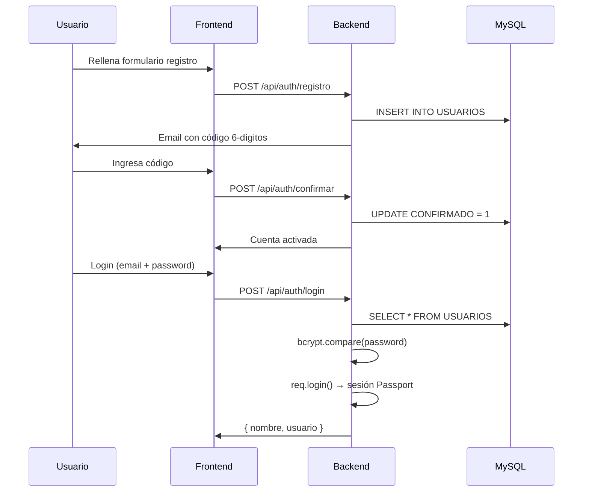

Diagrama de Arquitectura — Jadda Sports

```mermaid
graph TB
    subgraph "🌐 Cliente Web"
        FRONTEND["Frontend React + Vite<br/>Puerto 5173"]
        NAVBAR["Navbar + AuthContext"]
        CART["FloatingCart + MiniCartMenu"]
        ROUTES["React Router:<br/>/, /catalogo, /login,<br/>/perfil, /admin, /pqr"]
    end

    subgraph "📱 App Móvil"
        MOBILE["React Native + Expo<br/>Expo SDK 54"]
        MOBILE_AUTH["AuthContext"]
        MOBILE_TABS["Bottom Tabs:<br/>Inicio, Catálogo,<br/>Carrito, Perfil"]
    end

    subgraph "⚙️ Backend API"
        BACKEND["Node.js + Express 5<br/>Puerto 5000"]
        SETUP["setup.js<br/>(Auto-create tables + seed)"]
        
        subgraph "Rutas API"
            AUTH["/api/auth<br/>(registro, login, logout)"]
            PRODUCTOS["/api/productos<br/>(CRUD, variantes, reseñas)"]
            CARRITO["/api/carrito<br/>(agregar, listar, eliminar)"]
            CHECKOUT["/api/checkout/procesar<br/>(transacción con SELECT ... FOR UPDATE)"]
            DIRECCIONES["/api/direcciones<br/>(CRUD direcciones)"]
            CUPONES["/api/cupones/validar"]
            FAVORITOS["/api/favoritos"]
            COMPRAS["/api/compras"]
            PQR["/api/pqr"]
            POSTVENTA["/api/devoluciones<br/>(multiproducto, evidencias,<br/>4 decisiones)"]
            CHAT["/api/chat<br/>(conversaciones, escalar)"]
            VENDEDOR["/api/vendedor<br/>(tienda, productos,<br/>ventas envío/estado, reportes)"]
            PAGOS["/api/pagos<br/>(config · pagar · estado/:id ·<br/>webhook Wompi firmado)"]
            APOYO["/api/envio · /api/newsletter · /api/contacto ·<br/>/api/notificaciones · /api/historial · /api/planes ·<br/>/api/admin · /api/retos · /api/pqr"]
        end
        
        subgraph "Middleware"
            SESSION["express-session +<br/>MySQL Store"]
            PASSPORT["Passport.js<br/>(Local, Google, Facebook)"]
            BCRYPT["bcrypt"]
            SEGURIDAD["helmet · CSRF origen ·<br/>RateLimit · registroPeticiones ·<br/>trust proxy · fail-fast secretos"]
            STATIC["/images privadas con<br/>autorización por recurso"]
        end
    end

    subgraph "☁️ Media"
        CLOUD["Cloudinary (primario)<br/>jadda/productos · perfiles ·<br/>retos · devoluciones · estaticos"]
        DISCO["Fallback disco<br/>backend/uploads/*<br/>(bind-mounts frontend/public/images)"]
    end

    subgraph "💳 Pasarela de Pagos (externa)"
        WOMPI["Wompi (sandbox)<br/>Checkout Redirect<br/>widget firmado"]
    end

    subgraph "🗄️ Base de Datos"
        DB["MySQL 8.0<br/>Docker Container<br/>Puerto 3306"]
    end

    subgraph "🐳 Infraestructura"
        DOCKER["Docker Compose"]
        VOLUME["Volume: mysql_data"]
    end

    FRONTEND -->|"HTTP :5000"| BACKEND
    MOBILE -->|"HTTP :5000"| BACKEND
    BACKEND -->|"mysql2 parametrizado"| DB
    SETUP -->|"CREATE TABLE + INSERT IGNORE"| DB
    BACKEND -->|"subidas (CLOUDINARY_URL)"| CLOUD
    CLOUD -.->|"si falla o sin credenciales"| DISCO
    PAGOS -->|"POST /v1/tokens · GET /v1/transactions"| WOMPI
    WOMPI -.->|"POST /api/pagos/webhook (HMAC SHA256)"| PAGOS
    DB -->|"persiste datos"| VOLUME
```



## Flujo de Autenticación



## Flujo de Compra

```mermaid
sequenceDiagram
    participant U as Usuario
    participant F as Frontend
    participant B as Backend
    participant DB as MySQL
    participant W as Wompi

    U->>F: Agrega producto al carrito
    F->>F: CartContext (frontend state)
    U->>F: Abre carrito flotante
    U->>F: Va a /resumencompra
    F->>F: Calcula subtotales + total
    U->>F: Agrega dirección
    F->>B: POST /api/direcciones
    B->>DB: INSERT INTO DIRECCIONES
    U->>F: Selecciona método de pago
    U->>F: Aplica cupón (opcional)
    F->>B: POST /api/cupones/validar
    B->>DB: SELECT FROM DESCUENTOS
    U->>F: Confirma compra
    F->>B: POST /api/checkout/procesar
    B->>DB: Transacción: SELECT ... FOR UPDATE (stock real por variante)
    B->>DB: UPDATE PRODUCTO_VARIANTES SET STOCK = STOCK - ? WHERE ID_VARIANTE = ? AND STOCK >= ? (409 si 0 filas)
    B->>DB: INSERT INTO VENTAS + DETALLE_VENTAS + ENVIOS + MOVIMIENTOS_STOCK (SALIDA)
    B->>F: Venta creada (COMPLETADA sin pasarela; PENDIENTE_PAGO con PAYMENT_GATEWAY=wompi)

    alt Pasarela activa (Wompi)
        F->>B: GET /api/pagos/config (al montar /resumencompra)
        B-->>F: { gateway: wompi, pruebas: true }
        U->>F: Confirmar e ir a pagar
        F->>B: POST /api/checkout/procesar → POST /api/pagos/pagar (mismo click)
        B->>B: firmaIntegridad = SHA256(ref + centavos + moneda + secreto)
        B->>DB: UPDATE REFERENCIA_PAGO con guard (solo dueño y PENDIENTE_PAGO)
        B-->>F: urlCheckout del widget (signature:integrity)
        F->>W: Pestaña nueva al checkout de Wompi
        F->>F: La página queda en /compra-exitosa/:id
        U->>W: Paga (sandbox: 4242…) o declina
        W->>B: POST /api/pagos/webhook (checksum SHA256 del evento)
        B->>B: Verifica firma + idempotencia (PAGOS_EVENTOS)
        B->>W: Re-obtiene la transacción vía API
        B->>DB: APPROVED → VENTAS CONFIRMADA + factura/avisos
        loop Mientras PENDIENTE_PAGO (CompraExitosa, cada 3,5 s)
            F->>B: GET /api/pagos/estado/:id
            B-->>F: PENDING | APPROVED → ¡Gracias por tu compra! | DECLINED → volver a pagar
        end
        opt Ventana vencida (PAGOS_EXPIRA_MINUTOS, 10 min por defecto)
            B->>DB: Job cada 1 min → CANCELADA (CANCELADA_POR=SISTEMA) + ENTRADA stock + correo «Pedido cancelado ⏰»
        end
    end
```
