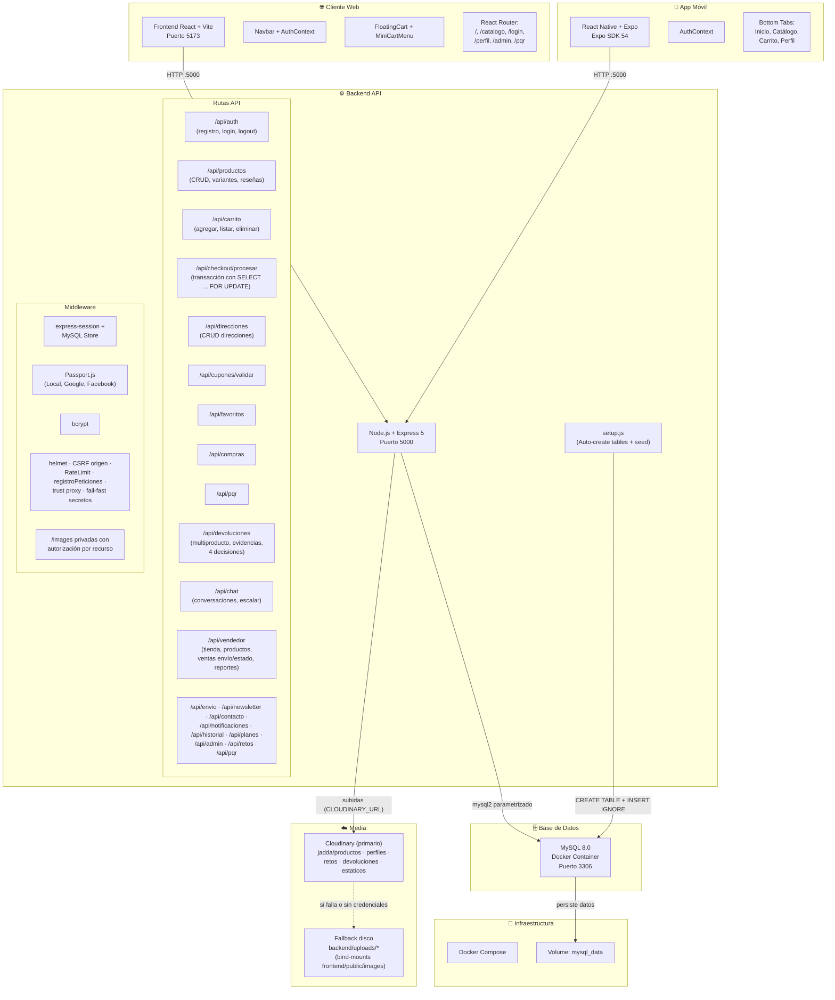
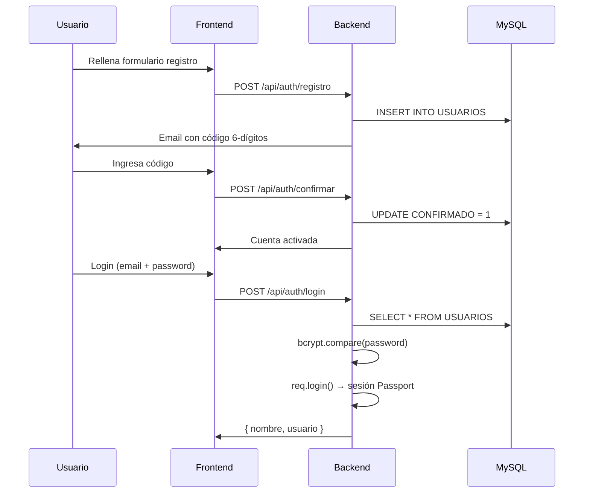

Diagrama de Arquitectura — Jadda Sports



## Flujo de Autenticación



## Flujo de Compra

```mermaid
sequenceDiagram
    participant U as Usuario
    participant F as Frontend
    participant B as Backend
    participant DB as MySQL

    U->>F: Agrega producto al carrito
    F->>F: CartContext (frontend state)
    U->>F: Abre carrito flotante
    U->>F: Va a /resumencompra
    F->>F: Calcula subtotales + total
    U->>F: Agrega dirección
    F->>B: POST /api/direcciones
    B->>DB: INSERT INTO DIRECCIONES
    U->>F: Selecciona método de pago
    U->>F: Aplica cupón (opcional)
    F->>B: POST /api/cupones/validar
    B->>DB: SELECT FROM DESCUENTOS
    U->>F: Confirma compra
    F->>B: POST /api/checkout/procesar
    B->>DB: Transacción: SELECT ... FOR UPDATE (stock real por variante)
    B->>DB: UPDATE PRODUCTO_VARIANTES SET STOCK=STOCK-? AND STOCK>=? (409 si 0 filas)
    B->>DB: INSERT INTO VENTAS + DETALLE_VENTAS + ENVIOS
    B->>F: Compra exitosa (COMPLETADA; PENDIENTE_PAGO si PAYMENT_GATEWAY)
```
