# Diagrama de Base de Datos — Jadda Sports

> Definición formal de cada tabla (columnas, tipos, llaves, estados) en el [Diccionario de Datos](diccionario-de-datos.md).

## Entidades y Relaciones

```mermaid
erDiagram
    ROLES ||--o{ USUARIOS : tiene
    USUARIOS ||--o{ DIRECCIONES : registra
    USUARIOS ||--o{ VENTAS : realiza
    USUARIOS ||--o{ RESENAS : escribe
    USUARIOS ||--o{ FAVORITOS : guarda
    USUARIOS ||--o{ PQR : crea
    USUARIOS ||--o{ NOTIFICACIONES : recibe
    USUARIOS ||--o{ RETOS_USUARIOS : participa
    USUARIOS ||--o{ USUARIOS_METODOS_PAGO : registra
    USUARIOS ||--o{ AVISOS_STOCK : suscribe
    USUARIOS ||--o{ CHAT : inicia
    CATEGORIAS ||--o{ PRODUCTOS : clasifica
    CATEGORIAS ||--o{ PLANTILLAS_PLANES : agrupa
    PROVEEDORES ||--o{ PRODUCTOS : provee
    DESCUENTOS ||--o{ PRODUCTOS : descuenta
    PRODUCTOS ||--o{ PRODUCTO_VARIANTES : tiene
    PRODUCTOS ||--o{ PRODUCTO_IMAGENES : contiene
    PRODUCTOS ||--o{ PRODUCTO_CARACTERISTICAS : detalla
    PRODUCTOS ||--o{ RESENAS : recibe
    PRODUCTOS ||--o{ FAVORITOS : incluido
    PRODUCTOS ||--o{ DETALLE_VENTAS : vendido_en
    PRODUCTOS ||--o{ MOVIMIENTOS_STOCK : registra
    PRODUCTOS ||--o{ CARRITO : en_carrito
    PRODUCTOS ||--o{ HISTORIAL : visto_en
    PRODUCTO_VARIANTES ||--o{ DETALLE_VENTAS : en
    PRODUCTO_VARIANTES ||--o{ AVISOS_STOCK : alerta
    PRODUCTO_VARIANTES ||--o{ CARRITO : variante
    VENTAS ||--o{ DETALLE_VENTAS : contiene
    VENTAS ||--o{ ENVIOS : envia
    VENTAS ||--o{ DEVOLUCIONES : origina
    VENTAS ||--o{ PLANES_USUARIO : genera
    VENTAS ||--o{ PAGOS_EVENTOS : registra
    VENTAS }o--|| METODOS_PAGO : usa
    VENDEDORES ||--o{ PRODUCTOS : publica
    VENDEDORES ||--o{ CHAT : atiende
    SOLICITUDES_VENDEDOR ||--o{ VENDEDORES : aprueba
    RETOS ||--o{ RETOS_USUARIOS : asigna
    RETOS_USUARIOS ||--o{ RETO_EVIDENCIAS : evidencia
    DEVOLUCIONES ||--o{ DEVOLUCIONES_EVIDENCIAS : documenta
    CHAT ||--o{ CHAT_MENSAJE : contiene
    PLANTILLAS_PLANES ||--o{ PLANES_USUARIO : instancia
```

## Estructura de Tablas

### USUARIOS
| Columna | Tipo | Descripción |
|---------|------|-------------|
| ID_USUARIO | INT (PK) | Auto-incremental |
| NOMBRE_USUARIO | VARCHAR | Nombre del usuario |
| APELLIDO_USUARIO | VARCHAR | Apellido |
| EMAIL | VARCHAR (Unique) | Correo electrónico |
| USUARIO | VARCHAR | Nombre de usuario |
| CONTRASENA | VARCHAR | Hash bcrypt |
| ID_ROL | INT (FK) | Relación con ROLES |
| CONFIRMADO | TINYINT | Email verificado (1/0) |
| TOKEN | VARCHAR | Hash bcrypt del código de 6 dígitos (ya no texto plano) |
| TOKEN_EXPIRA | DATETIME | Expiración del token |
| TELEFONO | VARCHAR | Teléfono de contacto |
| FECHA_REGISTRO | DATETIME | Fecha de creación |
| FOTO_URL | VARCHAR | URL de avatar |
| TIPO_DOCUMENTO | VARCHAR | Tipo de identificación |
| NUMERO_DOCUMENTO | VARCHAR | Número de identificación |
| AUTH_PROVIDER | VARCHAR | Proveedor de sesión (LOCAL, google, facebook) |
| PROVIDER_ID | VARCHAR | ID en el proveedor externo |
| EMAIL_PENDIENTE | VARCHAR | Correo nuevo pendiente de confirmar por código |
| DEBE_CAMBIAR_PASSWORD | TINYINT | Obliga a rotar la contraseña temporal (vendedores nuevos) |
| ULTIMA_CONEXION / ULTIMA_IP / ULTIMA_UBICACION | DATETIME / VARCHAR / VARCHAR | Registro de conexión (llena `registrarConexion` en login/social) |

### PRODUCTOS
| Columna | Tipo | Descripción |
|---------|------|-------------|
| ID | INT (PK) | Auto-incremental |
| NOMBRE | VARCHAR | Nombre del producto |
| PRECIO | DECIMAL(10,2) | Precio unitario |
| DESCRIPCION | TEXT | Descripción detallada |
| MARCA | VARCHAR | Marca del producto |
| ID_CATEGORIA | INT (FK) | Relación con CATEGORIAS |
| ID_PROVEEDOR | INT (FK) | Relación con PROVEEDORES |
| ID_DESCUENTO | INT (FK) | Relación con DESCUENTOS (opcional) |
| ID_VENDEDOR | INT (FK) | Relación con VENDEDORES (NULL = JADDA) |
| ESTADO_PUBLICACION | VARCHAR | NULL/APROBADO/PENDIENTE/RECHAZADO (NULL y APROBADO público) |

### PRODUCTO_VARIANTES
| Columna | Tipo | Descripción |
|---------|------|-------------|
| ID_VARIANTE | INT (PK) | Auto-incremental |
| ID_PRODUCTO | INT (FK) | Producto padre |
| COLOR | VARCHAR | Color de la variante |
| NOMBRE_ATRIBUTO | VARCHAR | Nombre del atributo (p. ej. Talla) |
| ATRIBUTO | VARCHAR | Valor del atributo (p. ej. M) |
| STOCK | INT | Cantidad disponible |

> UNIQUE `uq_variante_producto` sobre (ID_PRODUCTO, COLOR, NOMBRE_ATRIBUTO, ATRIBUTO).

### VENTAS
| Columna | Tipo | Descripción |
|---------|------|-------------|
| ID_VENTA | INT (PK) | Auto-incremental |
| ID_CLIENTE | INT (FK) | Comprador (USUARIOS) |
| FECHA_VENTA | DATETIME | Fecha de la compra |
| TOTAL | DECIMAL(10,2) | Monto total (calculado en servidor) |
| ESTADO | ENUM | COMPLETADA, PENDIENTE, CANCELADA, ENVIADA, CONFIRMADA, PENDIENTE_PAGO (solo si `PAYMENT_GATEWAY`) |
| ID_METODO | INT (FK) | Método de pago usado (METODOS_PAGO) |
| DATOS_PAGO | JSON | Snapshot sin campos sensibles (sin cvv/número completo) |
| REFERENCIA_PAGO | VARCHAR | Referencia externa del pago |

### RESENAS
| Columna | Tipo | Descripción |
|---------|------|-------------|
| ID_RESENA | INT (PK) | Auto-incremental |
| ID_USUARIO | INT (FK) | Autor de la reseña |
| ID_PRODUCTO | INT (FK) | Producto reseñado |
| CALIFICACION | INT (1-5) | Puntuación en estrellas |
| COMENTARIO | TEXT | Texto de la reseña |
| FECHA | DATETIME | Fecha de creación |

### FAVORITOS
| Columna | Tipo | Descripción |
|---------|------|-------------|
| ID_FAVORITO | INT (PK) | Auto-incremental |
| ID_USUARIO | INT (FK) | Usuario que guarda |
| ID_PRODUCTO | INT (FK) | Producto guardado |
| FECHA_AGREGADO | DATETIME | Fecha de adición |

### PQR
| Columna | Tipo | Descripción |
|---------|------|-------------|
| ID_PQR | INT (PK) | Auto-incremental |
| ID_USUARIO | INT (FK) | Usuario solicitante |
| TIPO | ENUM | Petición, Queja, Reclamo, Sugerencia |
| ASUNTO | VARCHAR | Título del caso |
| DESCRIPCION | TEXT | Descripción detallada |
| NUMERO_PEDIDO | VARCHAR | Opcional |
| ESTADO | ENUM | PENDIENTE, RESUELTO |
| FECHA_CREACION | DATETIME | Fecha de apertura |

### Otras tablas (36 en total)
- **ROLES**: ID_ROL, NOMBRE_ROL, DESCRIPCION
- **CATEGORIAS**: ID_CATEGORIA, NOMBRE_CATEGORIA, DESCRIPCION (UNIQUE `uq_categoria_nombre`)
- **PROVEEDORES**: ID_PROVEEDOR, NOMBRE_PROVEEDOR, CONTACTO_PROVEEDOR, TELEFONO_PROVEEDOR, EMAIL_PROVEEDOR
- **DESCUENTOS**: ID_DESCUENTO, DESCRIPCION, PORCENTAJE, FECHA_INICIO, FECHA_FIN, USADO, MONTO_MINIMO
- **PRODUCTO_IMAGENES**: ID_IMAGEN, ID_PRODUCTO, URL_IMAGEN, ORDEN
- **PRODUCTO_CARACTERISTICAS**: ID_CARACTERISTICA, ID_PRODUCTO, NOMBRE_ATRIBUTO, VALOR_ATRIBUTO
- **DIRECCIONES**: ID_DIRECCION, ID_USUARIO, DIRECCION, CIUDAD, DEPARTAMENTO, BARRIO, TELEFONO_CONTACTO, CODIGO_POSTAL, ETIQUETA, ES_PRINCIPAL
- **DETALLE_VENTAS**: ID_DETALLE, ID_VENTA, ID_PRODUCTO, ID_VARIANTE, CANTIDAD, PRECIO_UNITARIO, SUBTOTAL
- **METODOS_PAGO**: ID_METODO, NOMBRE_METODO, DESCRIPCION
- **MOVIMIENTOS_STOCK**: ID_MOVIMIENTO, ID_PRODUCTO, TIPO_MOVIMIENTO, CANTIDAD, FECHA
- **HISTORIAL**: ID_HISTORIAL, ID_USUARIO, ID_PRODUCTO, FECHA_VISTO
- **CARRITO**: ID_CARRITO, ID_USUARIO, ID_PRODUCTO, ID_VARIANTE, CANTIDAD, FECHA_AGREGADO
- **ENVIOS**: ID_ENVIO, ID_VENTA, DIRECCION_ENVIO, CIUDAD, BARRIO, DEPARTAMENTO, CODIGO_POSTAL, OBSERVACIONES, TELEFONO_CONTACTO, COSTO_ENVIO, ESTADO_ENVIO, FECHA_ENVIO, FECHA_ENTREGA
- **SESIONES** (`sessions`): session_id, expires, data (store de express-session)
- **RETOS**: ID_RETO, TITULO, DESCRIPCION, META_TIPO, META_VALOR, RECOMPENSA_PORCENTAJE, FECHA_INICIO, FECHA_FIN, ACTIVO
- **RETOS_USUARIOS**: ID_RETO_USUARIO, ID_RETO, ID_USUARIO, PROGRESO, COMPLETADO, CUPON_GENERADO
- **RETO_EVIDENCIAS**: ID_EVIDENCIA, ID_RETO_USUARIO, ID_USUARIO, TIPO, RUTA, RUTAS_EXTRA, CANTIDAD, ESTADO, OBSERVACION, FECHA_SUBIDA
- **NOTIFICACIONES**: ID_NOTIFICACION, ID_USUARIO (NULL = broadcast), TIPO, TITULO, MENSAJE, RUTA, LEIDA, FECHA
- **AVISOS_STOCK**: ID_AVISO, ID_VARIANTE, ID_USUARIO, FECHA_CREACION, ENVIADO
- **DEVOLUCIONES**: ID_DEVOLUCION, ID_USUARIO, ID_VENTA, ID_PRODUCTO, CANTIDAD, MOTIVO, DESCRIPCION, TIPO, OBSERVACION, ESTADO, FECHA_CREACION, FECHA_PROCESADA
- **DEVOLUCIONES_EVIDENCIAS**: ID_EVIDENCIA, ID_DEVOLUCION, TIPO, RUTA, FECHA
- **SOLICITUDES_VENDEDOR**: ID_SOLICITUD, ID_USUARIO (NULL si sin cuenta), NOMBRE_EMPRESA, NIT, NOMBRE_REPRESENTANTE, EMAIL_EMPRESA, TELEFONO, DEPARTAMENTO, CIUDAD, DIRECCION, CATEGORIAS, DESCRIPCION, ESTADO, FECHA_CREACION, FECHA_PROCESADA
- **VENDEDORES**: ID_VENDEDOR, ID_USUARIO, ID_SOLICITUD, NOMBRE_EMPRESA, NIT, EMAIL_VENDEDOR, TELEFONO, DEPARTAMENTO, CIUDAD, DIRECCION, CATEGORIAS, ESTADO, FECHA_REGISTRO
- **CHAT**: ID_CHAT, TIPO (SOPORTE/VENDEDOR/DEVOLUCION), ID_CLIENTE, ID_VENDEDOR, ID_DEVOLUCION, PARTE, ESTADO, FECHA_CREACION, ULTIMA_ACTIVIDAD
- **CHAT_MENSAJE**: ID_MENSAJE, ID_CHAT, ID_AUTOR, ROL_AUTOR, MENSAJE, LEIDO, FECHA
- **PLANTILLAS_PLANES**: ID_PLANTILLA, ID_CATEGORIA, TITULO, DESCRIPCION, DURACION_DIAS, NIVEL, CONTENIDO (JSON)
- **PLANES_USUARIO**: ID_PLAN, ID_USUARIO, ID_VENTA, ID_PLANTILLA, FECHA_INICIO, COMPLETADO
- **USUARIOS_METODOS_PAGO**: ID, ID_USUARIO, ID_METODO, TITULAR, TELEFONO, BANCO, TIPO, ES_PRINCIPAL, FECHA_CREADO
- **PAGOS_EVENTOS**: ID_EVENTO, PROVEEDOR (wompi), EXTERNO_ID (id de transacción del gateway), EVENTO, CHECKSUM (sha256 del webhook), ID_VENTA (resuelta por REFERENCIA_PAGO), ESTADO_PROCESADO (RECIBIDO/CONFIRMADA/CANCELADA/IGNORADO/FIRMA_INVALIDA), FECHA_RECEPCION — UNIQUE `uq_pagos_evento` (EXTERNO_ID, CHECKSUM) = idempotencia del webhook
- **VENDEDORES/PRODUCTOS**: `PRODUCTOS.ID_VENDEDOR` (NULL=JADDA, FK a VENDEDORES) + `ESTADO_PUBLICACION` (NULL/APROBADO/PENDIENTE/RECHAZADO)

> El esquema completo se define en `backend/database/setup.js` — las **36 tablas todas están en `CREATE_TABLES_RAW`** (`DEVOLUCIONES`, `DEVOLUCIONES_EVIDENCIAS` y `PAGOS_EVENTOS` incluidas; `setup.js` ejecuta `SET FOREIGN_KEY_CHECKS=0/1` alrededor del seeding). Las tablas `INVENTARIO` y `EMPLEADOS` fueron eliminadas por no usarse (stock se lleva por `PRODUCTO_VARIANTES.STOCK` + `MOVIMIENTOS_STOCK`). Se crea automáticamente al iniciar el backend. Para bases nuevas existe `backend/database/schema.sql` (generado con `node backend/database/exportarSchema.js`, incluye estructura + `SEED_DATA` + `DEMO_DATA` poblado) importable en MySQL Workbench. Ver `docs/README.md` para conteo.
