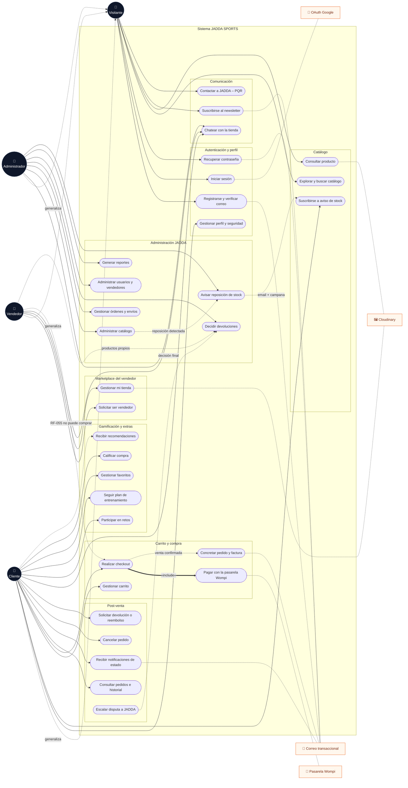

# 🎭 Diagrama de Casos de Uso — JADDA SPORTS

> Fuente única de los casos de uso del sistema. Cada CU traza contra los
> **61 RFs documentados** (`docs/RFs/`) y sus 61 HUs (`docs/HUs/`), todos
> verificados contra la implementación (corte 2026-10). La notación es UML
> "lite" en **Mermaid** (render nativo en GitHub): elipses = casos de uso,
> círculos = actores, líneas continuas = asociación, punteadas = relación
> («generaliza» / asociación con sistemas externos), dobles = «include».

## 1. Actores

| Actor | Rol (BD `ID_ROL`) | Descripción |
|-------|:-----------------:|-------------|
| 👤 **Visitante** | — | Sin sesión. Explora el catálogo, ve productos/opiniones, se registra, se autentica, se suscribe al newsletter y contacta a JADDA. No puede comprar ni guardar datos personales. |
| 👤 **Cliente** | 4 | Hereda todo lo del visitante y además compra, paga (tarjeta o pasarela Wompi), gestiona carrito/pedidos/devoluciones, participa en retos y planes, guarda favoritos y chatea. |
| 👤 **Vendedor** | 6 | Cuenta de tienda aprobada por el admin. Publica productos (pasan por revisión), gestiona sus ventas y reportes. **No puede comprar** (RF-055). Hereda la navegación del visitante. |
| 👤 **Administrador** | 1 | Equipo JADDA. Administra catálogo, órdenes/envíos, usuarios, solicitudes de vendedor, devoluciones (incluidas escaladas), reportes y chats de soporte. No puede abrir tickets: él es el soporte. |

Sistemas externos (actores secundarios no humanos):
**Wompi** (pasarela de pagos + webhook firmado), **Correo transaccional**
(SMTP/Brevo: códigos OTP, facturas, avisos, newsletter), **Cloudinary**
(imágenes/videos) y **Google** (OAuth).

## 2. Diagrama maestro (32 casos de uso)

### 2.1 Relaciones explicitadas

| Relación | Tipo | Sentido |
|----------|------|---------|
| Cliente / Vendedor / Admin → Visitante | «generaliza» | Los tres actores con sesión heredan la navegación del visitante (catálogo, producto, newsletter, PQR). |
| CU-09 Realizar checkout → CU-10 Pagar con Wompi | «include» | Con `PAYMENT_GATEWAY=wompi` todo checkout pasa obligatoriamente por la pasarela: la venta nace `PENDIENTE_PAGO`, el webhook firmado o el pull la confirman; sin pasarela la venta nace pagada (CU-10 es la variación opcional del entorno). |
| CU-09 → CU-11 Concretar pedido | flujo derivado | Al confirmarse la venta el sistema envía el correo con la factura PDF adjunta. |
| CU-27 Administrar catálogo → CU-32 Avisar reposición → CU-07 | flujo derivado | Al reponer stock el sistema notifica automáticamente a cada suscriptor (email + campana). |
| CU-16 Escalar disputa → CU-29 Decidir devoluciones | flujo derivado | La escalación abre hilos separados (comprador/vendedor) y deja la decisión al equipo JADDA. |
| Vendedor → CU-09 | **RF-055 bloqueo** | El carrito y el checkout rechazan la cuenta de vendedor a nivel frontend y API. |
| Vendedor → CU-29 | asociación parcial | El vendedor decide las devoluciones de SUS productos; las escaladas y los productos de JADDA las decide el admin. |

## 3. Catálogo de casos de uso con trazabilidad a RFs

| CU | Caso de uso | Actores | RFs que traza | Módulo |
|----|-------------|---------|---------------|--------|
| CU-01 | Registrarse y activar cuenta con código de 6 dígitos | Visitante | RF-001 | Autenticación |
| CU-02 | Iniciar sesión (local y por OAuth social) | Visitante, Cliente, Vendedor, Admin | RF-002, RF-044 | Autenticación |
| CU-03 | Recuperar/restablecer contraseña | Visitante | RF-003 | Autenticación |
| CU-04 | Gestionar perfil, seguridad, métodos de pago y foto | Cliente, Vendedor, Admin | RF-004, RF-005, RF-042, RF-045 | Perfil |
| CU-05 | Explorar, filtrar y ordenar catálogo | Visitante *(y con sesión)* | RF-006, RF-007, RF-008, RF-009 | Catálogo |
| CU-06 | Consultar producto (detalle, stock, opiniones, relacionados, compartir, recientemente vistos) | Visitante *(y con sesión)* | RF-010, RF-011, RF-012, RF-013, RF-037, RF-049 | Catálogo |
| CU-07 | Suscribirse a aviso de reposición de stock | Cliente | RF-035 | Catálogo · Inventario |
| CU-08 | Gestionar carrito y total | Cliente | RF-014, RF-015 | Carrito |
| CU-09 | Realizar checkout (cupón, dirección, envío por ubicación, método, resumen) | Cliente | RF-016, RF-017, RF-018, RF-019, RF-060 | Checkout |
| CU-10 | Pagar con la pasarela Wompi (widget firmado, webhook idempotente, expiración 10 min) | *(sistema/externo)* | RF-018 (sección pasarela) | Pagos |
| CU-11 | Concretar pedido: correo con factura PDF | *(sistema)* | RF-020, RF-021 | Checkout |
| CU-12 | Consultar pedidos, detalle e historial de compras | Cliente | RF-022, RF-024 | Post-venta |
| CU-13 | Recibir notificaciones de estado (email + campana in-app) | Cliente | RF-025, RF-043 | Notificaciones |
| CU-14 | Cancelar pedido (antes del despacho, con reembolso automático si estaba pagado) | Cliente | RF-023 | Post-venta |
| CU-15 | Solicitar devolución o reembolso (ventana 3 días post-entrega) | Cliente | RF-033 | Post-venta |
| CU-16 | Escalar disputa de devolución al equipo JADDA | Cliente, Vendedor | RF-051 | Post-venta |
| CU-17 | Chatear con tienda/vendedor/soporte | Cliente, Vendedor, Admin | RF-050 | Comunicación |
| CU-18 | Participar en retos y ganar cupón RETO- (1 avance/día según tipo, 3 retos activos máx.) | Cliente | RF-040, RF-054 | Gamificación |
| CU-19 | Seguir plan de entrenamiento con progreso diario | Cliente | RF-041 | Gamificación |
| CU-20 | Gestionar lista de deseos (favoritos) | Cliente | RF-036 | Catálogo |
| CU-21 | Calificar compra/producto con reseña | Cliente | RF-026 (+ver en CU-06 RF-013) | Post-venta |
| CU-22 | Recibir recomendaciones (comprados×3, favoritos×2, vistos×1) | Cliente | RF-038 (+RF-012 en ficha) | Catálogo |
| CU-23 | Suscribirse al newsletter (con enlace de desuscripción) | Visitante, Cliente | RF-047 | Comunicación |
| CU-24 | Contactar a JADDA (PQR, contacto y soporte) | Visitante, Cliente | RF-039, RF-048, RF-061 | Comunicación |
| CU-25 | Solicitar cuenta de vendedor (formulario público, informal permitido) | Visitante | RF-056 | Marketplace |
| CU-26 | Gestionar mi tienda (publicar con revisión, ventas, reportes Excel/PDF) | Vendedor | RF-059, RF-052, RF-053 | Marketplace |
| CU-27 | Administrar catálogo (productos, variantes, categorías, imágenes) | Admin | RF-027, RF-028, RF-029, RF-046 | Administración |
| CU-28 | Gestionar órdenes y envíos (stepper de estados hasta ENTREGADO) | Admin | RF-030, RF-031 | Administración |
| CU-29 | Decidir devoluciones (devolver/reembolsar/más pruebas/rechazar, escaladas incluidas) | Admin *(+vendedor p/ productos propios)* | RF-033, RF-051 | Administración |
| CU-30 | Administrar usuarios y solicitudes de vendedores (aprobar/rechazar con motivo) | Admin | RF-057, RF-058 | Administración |
| CU-31 | Generar reportes de ventas y productos más vendidos (Excel con fórmulas + PDF ejecutivo) | Admin | RF-032, RF-034 | Reportes |
| CU-32 | Avisar reposición de stock (envío automático tras reponer) | *(sistema)* | RF-035 | Inventario |

**Cobertura: los 61 RFs están trazados a al menos un CU** (RF-013 y RF-012
protagonizan dos CU de lectura —ver CU-06/CU-21 y CU-06/CU-22—, RF-033
aparece en el flujo del cliente y en la decisión del admin, RF-035 en la
suscripción y en el envío del aviso).

## 4. Restricciones de negocio que condicionan los casos de uso

| Regla | CU afectado | Fuente |
|-------|-------------|--------|
| El vendedor NO puede comprar (Swal + 403 en frontend y API) | CU-08, CU-09 | RF-055 |
| Cupón `RETO-` personal e intransferible: solo el ganador lo valida/usa y se revalida con `SELECT … FOR UPDATE` en el cobro | CU-09 | RF-054 |
| Retos por días/sesiones: 1 avance por día (el rechazo libera el reenvío); km/reps se ajustan (`clamp`) al restante; máx. 3 retos activos | CU-18 | RF-040 |
| Devolución/reembolso solo en la ventana de **3 días** post-entrega; reembolso sin devolución solo por defecto o no-coincidencia; en tránsito no se solicita nada | CU-15 | RF-033 |
| Cancelación pagada pre-despacho = reembolso automático (productos + costo de envío), sin pasar por el admin | CU-14 | RF-023 |
| Venta sin completar el pago expira a los **10 min** (`PAGOS_EXPIRA_MINUTOS`) y libera stock con movimiento compensatorio | CU-10 | RF-018 · RNF-017 |
| Checkout concurrente protegido con `SELECT … FOR UPDATE` por variante (409 si se agota) | CU-09 | RF-014 · RF-018 |
| Evidencias de retos/devoluciones: máx. 5 archivos × 25 MB, mimetype real validado | CU-18, CU-15 | RF-040 · RF-033 |
| El admin NO abre tickets de soporte: él los atiende | CU-24, CU-17 | RF-061 · RF-050 |

## 5. Cómo leer/actualizar este documento

- **Render**: GitHub lo dibuja nativo; también vale VS Code (extensión
  Mermaid) o <https://mermaid.live> pegando el bloque del §2.
- **Cambios de alcance**: si se agrega/modifica un RF, actualizar (1) el
  bloque `subgraph` correspondiente del §2, (2) la tabla del §3 y (3) la
  tabla de relaciones del §2.1. La fuente de verdad sigue siendo
  `docs/RFs/` + `docs/HUs/`; este archivo es la vista de estructuración
  (RUP) de ambos.
- **Diagrama resumido**: `docs/manuales/manual-tecnico.md` §3.4 conserva
  una versión condensada para el manual; esta es la versión completa.
