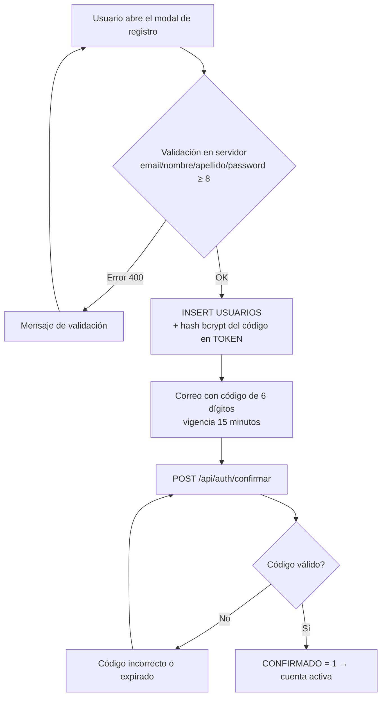
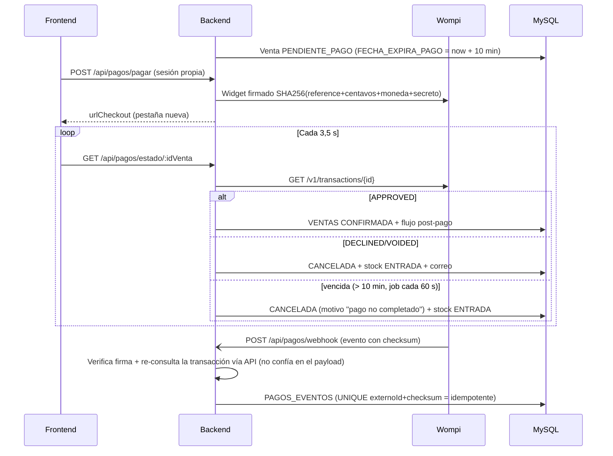
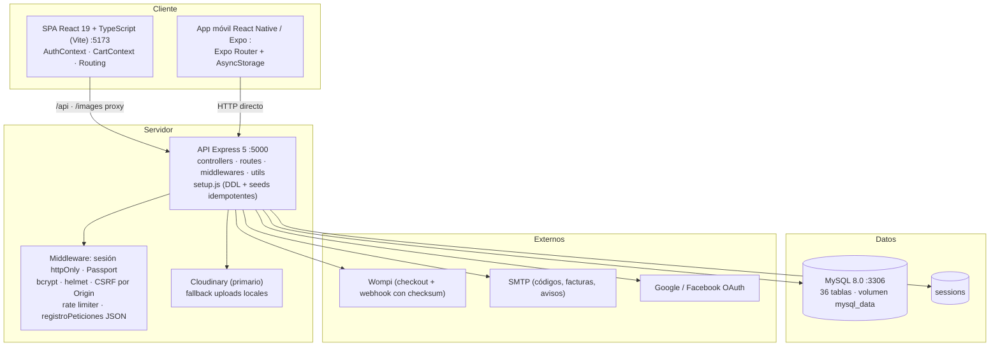
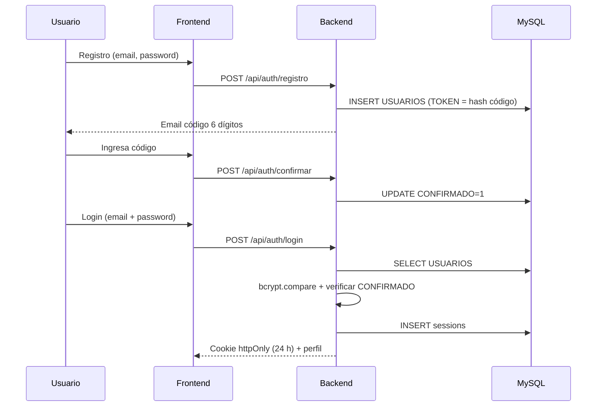
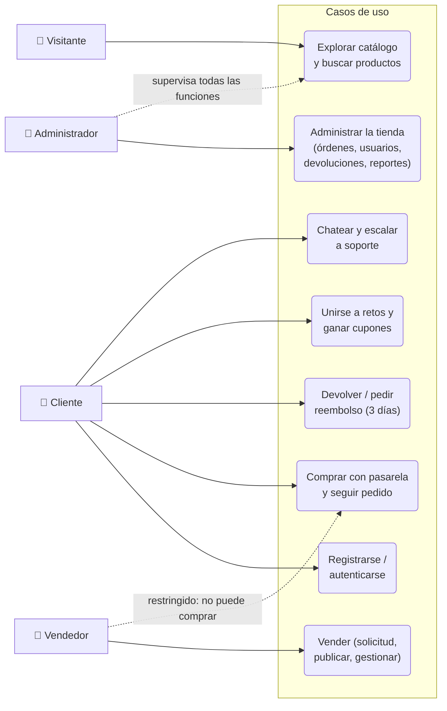

# Manual Técnico de la Aplicación — JADDA SPORTS

**Versión del documento:** 2.0 · 2026-10-30
**Audiencia:** desarrolladores y administradores técnicos del sistema
**Documentación complementaria:** `docs/diagrams/` (arquitectura, BD, flujos) · `docs/RFs/` (61 requisitos) · `docs/implantacion/` (despliegue, respaldos) · `docs/manuales/manual-instalacion.md`

> Manual estructurado según el formato requerido: Alcance · Descripción de procesos · Diagramas UML · Modelo relacional de la base de datos · Descripción de la plataforma · Documentación del código fuente · Acuerdos de niveles de servicio (SLA) · Administración de usuarios.

---

## 1. Alcance

E-commerce deportivo multiplataforma: **tienda web** (React 19 + TypeScript + Vite), **app móvil** (React Native/Expo) y **panel de administración** integrado en la web, sobre un **API Express** con MySQL 8. El sistema cubre: catálogo con variantes y reseñas, carrito y checkout con seguridad de concurrencia, pagos por pasarela Wompi (sandbox/test o producción), marketplace de vendedores externos con aprobación, gamificación (retos con cupones de un solo uso), planes de entrenamiento generados por compra, post-venta con devoluciones y reembolsos (automáticos por cancelación y con plazo de 3 días post-entrega), chat multi-actor con escalación a soporte, facturación PDF, notificaciones in-app + correo, newsletter automática y auditoría de stock.

Este manual describe la **arquitectura técnica, procesos de negocio, modelo de datos, plataforma de ejecución, administración de usuarios y acuerdos de servicio** del sistema desplegado en el cliente. La instalación paso a paso está en el *Manual de Instalación* y los requisitos funcionales detallados en `docs/RFs/`.

## 2. Descripción de procesos

### 2.1 Registro y verificación de cuenta



Código guardado como hash (no texto plano), expiración en BD (`TOKEN_EXPIRA`), reenvío limitado (rate 5/15 min por IP y máximo 3/30 min por correo).

### 2.2 Autenticación y sesión

El login valida bcrypt **antes** de revisar `CONFIRMADO` (401 genérico anti-enumeración de correos; solo con contraseña correcta responde 403 `requiereVerificacion`). La sesión se materializa con **express-session sobre cookie httpOnly** (persistencia en tabla `sessions`, 24 h) + **Passport.js** con 3 estrategias: local, Google y Facebook (OAuth web vía userinfo). El frontend expone el estado en `AuthContext`; los roles viajan en la sesión (`req.user.ID_ROL`).

### 2.3 Compra y checkout

1. El carrito vive en el servidor (`CARRITO`); el frontend lo sincroniza con `CartContext`.
2. En el resumen (3 pasos: envío → pago → confirmación) se calculan subtotal, cupones y costo de envío en servidor (`utils/envio.js`, gratis ≥ $800.000).
3. `POST /api/checkout/procesar` ejecuta una **transacción**: recalcula el total (ignora el del cliente), valida stock y cupones (compra mínima ANTES de abrir la transacción), y por cada variante hace `SELECT ... FOR UPDATE` + `UPDATE STOCK = STOCK - ? AND STOCK >= ?` (409 si otra venta ganó la carrera) + `MOVIMIENTOS_STOCK SALIDA`, inserta `VENTAS + DETALLE_VENTAS + ENVIOS` y genera el plan de entrenamiento si aplica.
4. **Guard de rol**: los vendedores (rol 6) no pueden comprar (403 en carrito y checkout).
5. Con pasarela activa la venta nace `PENDIENTE_PAGO` (ver 2.4); sin pasarela nace `COMPLETADA` y corre el flujo post-pago completo (correo al cliente con factura PDF adjunta, notificaciones a comprador/admin/vendedor y limpieza del carrito).

### 2.4 Pagos con la pasarela Wompi



- La sesión de pago es **idempotente**: repetir "Pagar" reusa la misma URL (`UPDATE ... WHERE ESTADO='PENDIENTE_PAGO'`).
- Referencias `JADDA-<idVenta>-<rand8>`; eventos autenticados con checksum SHA256 (propiedades del evento + timestamp + secreto de eventos, `utils/pagos.js`).
- **Cancelación con reembolso automático**: si el cliente (o admin/vendedor) cancela una venta pagada que no salió del almacén, se crean filas `DEVOLUCIONES APROBADA` (productos + costo de envío) sin pasar por revisión; si el envío ya salió, no se reembolsa.

### 2.5 Post-venta: devoluciones y reembolsos (3 días post-entrega)

1. Ventana: solo ventas `COMPLETADA` con envío `ENTREGADO` (o legado sin `ENVIOS`, usando `FECHA_VENTA`) y dentro de **3 días** desde `FECHA_ENTREGA`.
2. **Reembolso sin devolución** (whitelist): solo por "Producto llegó dañado o defectuoso" o "Producto no coincide con la descripción".
3. **Devolución** (cambio de opinión u otros motivos): formulario multi-producto con evidencias (multer: 25 MB × 5 archivos, validación de MIME real por magic bytes en `utils/validarSubida.js`).
4. El admin (o el vendedor dueño del producto) resuelve con 4 decisiones: **devolver** (reingresa stock + movimiento), **reembolsar**, **mas_pruebas** (el usuario adjunta más evidencias y vuelve a *Solicitada*) o **rechazar** (observación obligatoria visible al cliente).
5. Cada solicitud de producto de vendedor abre un **chat de devolución**; el desacuerdo se **escala**: se cierra el hilo de acuerdo y JADDA abre hilos separados con cada parte (`CHAT.PARTE`), y la decisión final cierra todos los hilos con un mensaje del sistema.

### 2.6 Retos deportivos y cupones

1. El usuario se une a un reto (máximo **3 activos**: el backend cuenta `RETOS_USUARIOS` no completados y responde 400 en el 4º).
2. Reporta avance vía multipart (`materiales[]`, 25 MB × 5) o suma directa sin material; los avances con material quedan `pendiente` de revisión (≤ 24 h; el material se **conserva** tras aprobar/rechazar, con `OBSERVACION` opcional visible al usuario).
3. Al aprobarse suma cantidad; al llegar a la meta se genera cupón `RETO-XXXX-XXXX` (30 días, un solo uso, compra mínima según % en `utils/reglasCupones.js`) insertado en `DESCUENTOS` con `USADO=0` y ligado en `RETOS_USUARIOS.CUPON_GENERADO`.
4. En checkout los cupones `RETO-` se marcan `USADO=1` dentro de la transacción; un cupón usado/vencido no aplica.

### 2.7 Marketplace de vendedores

1. `POST /api/vendedor/solicitud` (pública o con sesión; empresa/NIT opcionales para vendedor informal; anti-duplicado por NIT/email).
2. El admin procesa: **APROBADA** crea usuario rol 6 con la cuenta de la empresa, contraseña temporal `DEBE_CAMBIAR_PASSWORD=1` y credenciales por correo; **RECHAZADA** guarda `OBSERVACION_ADMIN` y notifica (permite reenvío sobre la misma fila).
3. El vendedor publica productos (nacen `PENDIENTE`, editados vuelven a `PENDIENTE`); el admin aprueba/rechaza con observación. Solo `APROBADO` (o legacy con `ESTADO_PUBLICACION IS NULL`) se publica: filtro aplicado en todos los endpoints públicos (catálogo, recomendados, carrito del checkout, newsletter, historial).
4. El vendedor gestiona **sus** ventas (guard `ventaDelVendedor`; el admin es solo lectura en ajenas y su UPDATE se rechaza con 403), sus devoluciones, chats y descarga reportes Excel/PDF (`reporteVendedorExcel.js` / `reporteVendedorPdf.js`).

### 2.8 Procesos de soporte y operación transversal

| Proceso | Descripción |
|---------|-------------|
| **Chat** (usuario↔vendedor↔admin) | Tipos SOPORTE/VENDEDOR/DEVOLUCION; idempotente; badges de no leídos por rol; filtro de groserías (~70 palabras, asteriscos de longitud igual, solo palabras completas); escalación con hilos por `PARTE` |
| **Mesa de ayuda interna** | PQR por formulario, contacto público con rate limit, FAQ |
| **Notificaciones in-app** | `NOTIFICACIONES` globales o por usuario; admin ve globales + propias; rutas de destino por destinatario (cliente → perfil, vendedor → su panel, admin → /admin/…) |
| **Newsletter** | Scheduler cada `NEWSLETTER_INTERVAL_HORAS` (default 72 h): oferta real de BD con imágenes embebidas, 4 plantillas, desuscripción con página de confirmación, historial en `backend/data/` |
| **Avisos de stock** | Suscripción por variante agotada; el reingreso (admin/vendedor) dispara correo + notificación y `ENVIADO=1` |
| **Plan de entrenamiento** | Generado al comprar un producto `PLANES`; progreso de días persistido en `backend/data/planes-progreso.json` |
| **Historial de navegación** | `HISTORIAL` en servidor con sesión (alimenta recomendados por 3 señales: comprado ×3, favorito ×2, visto ×1) |

## 3. Diagramas UML

Los diagramas están escritos en **Mermaid** (render nativo en GitHub y editores compatibles) y son equivalentes UML: de componentes (arquitectura), de secuencia (procesos) y de casos de uso (actores). Fuente estable: `docs/diagrams/arquitectura.md` y `docs/diagrams/flujos.md`.

### 3.1 Diagrama de componentes (arquitectura)



### 3.2 Diagrama de secuencia — Autenticación



### 3.3 Diagrama de secuencia — Compra y cobro

Ver el diagrama completo de la sección **2.4** (pull de confirmación, webhook idempotente y expiración de venta de 10 min con reingreso de stock).

### 3.4 Diagrama de casos de uso (actores y usos principales)



## 4. Modelo relacional de la base de datos

Modelo físico completo (36 tablas) en **`docs/Modelo relacional/Jadda Sports, modelo relacional.png`** (diagrama ERD de MySQL Workbench):


Agrupación funcional (todas las columnas están en `backend/database/schema.sql`):

| Dominio | Tablas principales |
|---------|--------------------|
| Usuarios y acceso | USUARIOS, ROLES, DIRECCIONES, USUARIOS_METODOS_PAGO, sessions |
| Catálogo | CATEGORIAS, PRODUCTOS, PRODUCTO_IMAGENES (ORDEN), PRODUCTO_VARIANTES (STOCK), PRODUCTO_CARACTERISTICAS, PROVEEDORES, DESCUENTOS (USADO, MONTO_MINIMO), RESENAS |
| Ventas | CARRITO, VENTAS, DETALLE_VENTAS (ID_VARIANTE), ENVIOS (ESTADO_ENVIO, COSTO_ENVIO, FECHA_ENTREGA), MOVIMIENTOS_STOCK, PAGOS_EVENTOS |
| Post-venta | DEVOLUCIONES (solicitudes multi-producto con estados SOLICITADA/MAS_PRUEBAS/APROBADA/RECHAZADA) + DEVOLUCIONES_EVIDENCIAS |
| Gamificación | RETOS, RETOS_USUARIOS, RETO_EVIDENCIAS (RUTA conservada, OBSERVACION) |
| Marketplace | SOLICITUDES_VENDEDOR, VENDEDORES |
| Comunicación | NOTIFICACIONES, AVISOS_STOCK, CHAT (+ PARTE), CHAT_MENSAJE (ROL_AUTOR), PQR |
| Otros | PLANTILLAS_PLANES, PLANES_USUARIO, HISTORIAL — el estado de newsletters/días de planes vive en `backend/data/*.json` |

**Reglas de integridad relevantes:** FK de `DETALLE_VENTAS.ID_VARIANTE` con `ON DELETE SET NULL` (la venta histórica sobrevive al borrado de variantes); `CARRITO` en cascada con el usuario; unicidad de suscripción por usuario/variante en `AVISOS_STOCK` y de eventos de pago (`UNIQUE externoId + checksum`); cupones `RETO-` protegidos por la bandera `USADO`; el identificador visible del pedido es un hash estable de Knuth sobre `ID_VENTA` (sin columnas extra).

**Regla de oro:** todo cambio de esquema se hace en `setup.js` (`CREATE_TABLES_RAW` + lista `MIGRACIONES` idempotente) y se regenera `schema.sql` con `node backend/database/exportarSchema.js`. Las migraciones se aplican en el arranque del backend tanto en desarrollo como en producción (idempotentes).

## 5. Descripción de la plataforma

| Capa | Tecnología |
|------|-----------|
| Frontend web | React 19, TypeScript, Vite 5, React Router, Bootstrap (parcial), SweetAlert2, react-icons |
| Móvil | React Native, Expo SDK 54, expo-router, AsyncStorage |
| Backend | Node.js 22, Express 5 (CommonJS), express-session + Passport.js (Google/Facebook/local), multer 2.2 (subidas streaming), pdfkit (facturas y reportes), exceljs (reportes), nodemailer |
| Base de datos | MySQL 8.0, driver mysql2, pool de conexiones |
| Media | Cloudinary (primario; carpetas `jadda/productos|perfiles|retos|devoluciones`) con fallback a disco (`backend/uploads/*` bind-mounts de `frontend/public/images/*`) |
| Infraestructura | Docker Compose: 3 servicios en dev (`jadda_mysql`, `jadda_backend`, `jadda_frontend`, con healthchecks y volúmenes persistentes) y stack de producción con MySQL sin puertos expuestos (`docker-compose.prod.yml`), backend `NODE_ENV=production` con setup idempotente al arranque y nginx (`deploy/nginx.conf`, TLS 1.2/1.3) |

**Características de operación:**

- **Puertos**: 3306 (MySQL, solo administración local), 5000 (API), 5173 (SPA). La app móvil consume `EXPO_PUBLIC_API_URL` al backend.
- **Sondas de salud**: `GET /health` y `/api/health` (JSON sincrónico, exentas del rate limiter); healthchecks de Docker en compose dev y prod.
- **Registro de peticiones**: una línea JSON por petición con id de correlación `X-Request-Id` en respuesta y log (sin PII, sin query strings); respuestas 400/413/429 reales vía error handler que honra `err.status`.
- **CORS configurable** (`CORS_ORIGINS`) + **CSRF por verificación de Origin** en mutaciones; cookies SameSite=Lax (same-origin en producción) y headers helmet.
- **Sesiones**: cookie httpOnly 24 h con persistencia en tabla `sessions`; `POST /api/auth/logout` cierra la sesión del navegador actual.
- **Entrada/salida**: límites `express.json` generales (≤ 25 MB base64 en rutas de subida de imágenes), multipart por multer (25 MB/archivo evidencias, 6 MB imagen de producto), todo validado en `utils/validarSubida.js` y `imagenController.js`.

## 6. Documentación del código fuente

### 6.1 Estructura del repositorio

```
backend/
├── controllers/        # lógica por dominio (auth, producto, checkout, pagos, devolucion, retos, chat, ...)
├── routes/             # definición de endpoints + middlewares por ruta
├── middlewares/        # esAdmin, esVendedor, rateLimiter (memoria), proteccionOrigen (CSRF), registroPeticiones
├── utils/              # envio, facturaPdf, estadoPedido, correo, pagos (Wompi), validarSubida,
│                       # movimientosStock, carpetaUsuario, reembolsosCancelacion + cancelacionVenta,
│                       # reporteDatos/Excel/Pdf (admin) y reporteVendedor* (vendedor), reglasCupones
├── database/
│   ├── setup.js        # FUENTE DE VERDAD DEL ESQUEMA: CREATE + MIGRACIONES idempotentes + seeds
│   ├── schema.sql      # exportación oficial para BD nuevas (Workbench)
│   └── exportarSchema.js
├── config/             # passport.js (3 estrategias), mailer (timeouts), origenesAdmitidos
├── assets/             # LogoJadda.png (+ assets de factura/reportes)
├── uploads/            # archivos subidos (bind mounts; no versionados)
└── server.js           # arranque: setup → static /images → rutas → schedulers (newsletter, expiración)

frontend/
├── src/pages|admin|vendedor/   # vistas cliente / administración / vendedor
├── src/context/                # AuthContext, CartContext, FavoritosContext, historial…
├── src/utils/                  # estadoCompra, wompiWindow, reglasCupon (espejo backend), escapeHtml, navigationGuard
├── public/images/              # imágenes servidas y destino real de las subidas locales
└── vite.config.ts              # proxy /api,/images → backend (server Y preview)

movil/app/                # pantallas Expo Router ((tabs), producto/[id], perfil)
docs/                     # RFs, HUs, RNFs, diagramas, implantación, manuales, calidad, entregables
tests/                    # smoke.mjs + Playwright E2E (smoke.spec.ts)
scripts/                  # backup.ps1, restaurar-backup.ps1, mediciones-rnf.ps1, sql/usuarios-produccion.sql
deploy/                   # nginx.conf + docker-compose.caddy.yml (reverse proxy)
```

### 6.2 Mapa de API

Prefijo global `/api`. Autenticación entre corchetes.

**Auth — `/api/auth`** — `POST registro` (hash del código, vigencia 15 min) · `POST login` [rate 10/15 min] · `POST social-login` · `POST confirmar` · `POST reenviar-codigo` · recuperar contraseña (`recuperar-password`, `verificar-codigo`, `update-password`) · OAuth Google/Facebook · [sesión] `GET perfil`, `PUT perfil`, `POST foto`, `POST cambiar-password`, `POST cambiar-email` + `confirmar-cambio-email`, `POST verificar-password`, `POST logout`, `GET usuario` (rol).

**Catálogo — `/api/productos`** — `GET /` (prefijo, rating, stock) · `GET categorias|descuentos|recomendados` (recomendados por 3 señales: comprados ×3, favoritos ×2, vistos ×1) · `GET :id`, `:id/variantes`, `:id/caracteristicas`, `:id/resenas`, `relacionados/:id` · `POST :id/resenas` [sesión] · CRUD productos/categorías/descuentos/variantes [esAdmin] · `POST imagenes` (≤ 8 × 6 MB) [esAdmin/esVendedor] · avisos de stock (`variantes/:id/suscribir|suscripcion`) [sesión].

**Carrito y checkout** — `/api/carrito`: agregar/actualizar/eliminar [sesión] · `/api/checkout/procesar`: transacción `FOR UPDATE` por variante (409 en carrera de stock), decremento + `MOVIMIENTOS_STOCK`, cupones con compra mínima pre-transacción, venta `PENDIENTE_PAGO` (pasarela) o `COMPLETADA`; guard anti-vendedores.

**Pagos — `/api/pagos`** — `GET config` · `POST pagar` [sesión, rate 8/5 min] (URL firmada idempotente `JADDA-<id>-<rand8>`) · `GET estado/:idVenta` [sesión, rate 90/min] (pull con expiración de 10 min) · `POST webhook` [público, rate 60/min, checksum + re-consulta + `PAGOS_EVENTOS` idempotente].

**Mis compras — `/api/compras` [sesión]** — listado/detalle con `DEVOLUCION_TIPOS`, `PAGO_CONFIRMADO`, `CANCELADA_POR`; `GET :id/factura` (PDF); `POST :id/cancelar` (no cancelable en EN_CAMINO/ENTREGADO; con pago confirmado ejecuta **reembolso automático** vía `utils/cancelacionVenta.js`: productos + envío si no despachó, `CANCELADA_POR=CLIENTE/TIENDA/SISTEMA`); `PUT :id/direccion` (bloqueada si el envío salió).

**Devoluciones — `/api/devoluciones`** — [sesión] solicitud multi-producto con evidencias (25 MB × 5, magic bytes), mis solicitudes, `POST :id/evidencias` en MAS_PRUEBAS, `DELETE evidencias/:id` (solo pendientes) · [esAdmin] `GET admin` + `POST admin/:id/procesar` (devolver/reembolsar/mas_pruebas/rechazar) · [vendedor] gestión de las de sus productos. Vendedor/cliente conversan en chat (`CHAT`); la escalación crea hilos por `PARTE` y JADDA decide.

**Retos — `/api/retos`** — [sesión] listado, `unirse/:id_reto` (máximo 3 activos), `progreso/:id_reto_usuario` (multipart ≤ 25 MB × 5 o legacy base64), mis retos/evidencias, eliminar avance propio pendiente · [admin] `admin/evidencias` + `aprobar|rechazar` (con `OBSERVACION` opcional; material conservado).

**Admin — `/api/admin` [esAdmin]** — dashboard, pendientes (badges), órdenes (estado venta/envío + factura PDF + eliminar CANCELADAS con transacción), rechazo/aprobación de productos de vendedor, reportes (`reportes/ventas|excel|pdf`, `analytics/mas-vendidos`), usuarios (`usuarios`, `usuarios/:id` con compras/retos/direcciones/métodos/stats).

**Vendedor — `/api/vendedor`** — público `POST solicitud` (10/15 min) · `GET /solicitud` · [esVendedor] mi-tienda, CRUD de productos propios (PENDIENTE→aprobación), `PUT ventas/:id/envio|estado` (solo ventas suyas; la mixta cancela y reembolsa todos los productos), devoluciones, chats, `reportes/excel|pdf`, empresa · [en sesión admin] `GET admin` + `POST admin/:id/procesar`.

**Chat — `/api/chat` [sesión]** — `iniciar` (idempotente), `conversaciones` (rol-aware), `no-leidos` (badge), `:id/mensajes` (GET/POST con filtro de groserías), `:id/escalar` (abre hilos por PARTE), cierre por decisión de devolución.

**Otros** — `/health` + `/api/health` · `/api/envio/calcular` · `/api/notificaciones` (timbre) · `/api/newsletter` (suscribir/desuscribir pública; admin: suscritos + envío manual) · `/api/contacto`, `/api/pqr` · `/api/favoritos` · `/api/historial` · `/api/planes` (listar, generar, marcar-día) · `/api/cupones` (`validar` + `disponibles`) · `/api/metodos-pago` · `/api/proveedores` · `/api/direcciones`.

### 6.3 Convenciones técnicas relevantes

- **Subidas**: Cloudinary si `CLOUDINARY_URL` está configurada (falla → multer escribe en disco con bind mount); carpetas por usuario `uploads/usuarios/<usuario>/perfil|retos/r<id>/` (Cloudinary: `jadda/perfiles/<usuario>/`, `jadda/retos/<usuario>/r<id>/`).
- **Validación de archivos**: tipo real por magic bytes + coherencia MIME↔extensión (`utils/validarSubida.js`).
- **Correo**: uso limitado try/catch — nunca bloquea la respuesta; las imágenes de correos se embeben como data-URI (Cloudinary → Buffer) y la factura PDF se adjunta.
- **Números de pedido** visibles: hash estable de Knuth sobre `ID_VENTA`.
- **Proxy**: `vite.config.ts` replica el proxy `/api` / `/images` en `server` y en `preview` (necesario para modo producción local).
- **Rate limiting**: en memoria por IP sobre rutas sensibles (login 10/15 min, registro 5/15 min, contacto 5/15 min, pagar 8/5 min, estado de pago 90/min, webhook 60/min) + límite global en `server.js` (desactivable con `DISABLE_RATE_LIMIT` en dev).
- **Build verificado**: `pnpm build` en contenedor (TypeScript estricto `tsc -b` + Vite) y `node --check` en backend antes del despliegue.

## 7. Descripción de los acuerdos de niveles de servicios (SLA)

Compromisos de servicio para la **operación del sistema en el cliente** (despliegue on-premise). Base documental: `docs/implantacion/02-plan-migracion-respaldos.md` (respaldos) y `docs/calidad/resultados-mediciones.md` (mediciones 2026-08-24, 10 muestras/endpoint).

### 7.1 Disponibilidad

| Compromiso | Valor y respaldo |
|-----------|-------------------|
| Objetivo de disponibilidad operativa en LAN | ≥ 99 % mensual (≤ ~7,3 h de indisponibilidad permitida) |
| Mecanismos garantizando la meta | Contenedores con `restart: always`; healthchecks Docker (backend `/health` cada 30 s, frontend con `start_period` 60 s); volumen persistente MySQL; ventana de mantenimiento nocturna (23:00–01:00) para actualizaciones |
| RPO (pérdida máxima de datos) | **24 h** — respaldo diario automatizado (Programador de tareas 23:00, rotación de 7 días, bitácora `backups/backup.log`, copia externa semanal recomendada) |
| RTO (tiempo de recuperación) | **≤ 1 h** — procedimiento documentado de 5 pasos con script (`restaurar-backup.ps1`); restauración de un dump completa medida: **~3,4 s** en BD de prueba |
| Verificación mensual de respaldo | Obligatoria: restaurar el último dump en BD temporal (`-BaseDatosPrueba`) para detectar respaldos corruptos antes de necesitarlos |

### 7.2 Rendimiento de referencia (medido, producción local)

| Endpoint | Promedio (ms) | P95 (ms) | Objetivo de servicio |
|----------|---------------|----------|----------------------|
| GET / (SPA) | 19,7 | 28,8 | p95 ≤ 250 ms |
| GET /api/productos | 39,6 | 51,2 | p95 ≤ 250 ms |
| GET /api/productos/1 | 23,0 | 29,9 | p95 ≤ 250 ms |
| GET /api/productos/categorias | 20,4 | 29,2 | p95 ≤ 250 ms |
| POST /api/auth/login (bcrypt) | 91,5 | 147,3 | p95 ≤ 500 ms |
| GET /api/auth/perfil | 23,7 | 34,0 | p95 ≤ 250 ms |

> Si una medición futura supera el objetivo, el endpoint entra en revisión (índices de BD / consultas N+1) según `docs/calidad/plan-mejora-continua.md` (los dashboards admin/vendedor ya usan consultas con granularidad + `LIMIT ?`).

### 7.3 Tiempos de negocio (SLA funcional)

| Solicitud del usuario | Compromiso del sistema |
|----------------------|------------------------|
| Confirmación de pago Wompi | Automática por sondeo 3,5 s o webhook; venta pendiente sin pagar se cancela a los **10 minutos** con reingreso de stock |
| Revisión de avance de reto | ≤ **24 horas** |
| Aprobación de solicitud de vendedor | ≤ **48 horas** con credenciales por correo |
| Resolución de devolución/reembolso | Con seguimiento visible; acreditación del dinero ≤ **7 días** desde aprobación; cancelación pagada sin despacho = **reembolso automático** inmediato (registro BD) |
| Newsletter | Cada 72 h (configurable) |
| Notificaciones de cambio de estado | Inmediatas por evento (correo + in-app) |

### 7.4 Soporte, incidentes y escalación

| Nivel | Responsable | Alcance |
|-------|-------------|---------|
| **N1 — Usuario** | Mesa de ayuda del sistema (chat "Nuevo soporte", PQR, contacto) | Consultas y problemas funcionales; el administrador del panel resuelve N1 |
| **N2 — Administrador del sistema (cliente)** | El operador técnico designado | Logs (`docker logs jadda_backend -f`, con id `X-Request-Id` correlado en cada respuesta de error), reinicios de contenedores, respaldos y restauración, conexión de la BD |
| **N3 — Equipo de desarrollo** | Mantenedores del código | Cambios de código, migraciones nuevas de esquema, integración de pasarela/correo/Cloudinary; canal: correo/issue |

**Flujo de incidente:** detección (healthcheck Down / reporte del usuario con `X-Request-Id`) → diagnóstico N2 con logs JSON → solución N2 (restart / restore) o **escalación N3** con el reporte → verificación con healthcheck + prueba de flujo afectado → acta en `backups/backup.log` o bitácora del cliente.

### 7.5 Continuidad y deuda conocida

| Riesgo registrado | Mitigación de servicio |
|-------------------|------------------------|
| Rate limiter en memoria | Reiniciar `jadda_backend` limpia los límites; no desactivar en producción; para multi-instancia migrar a store persistente |
| Sin HTTPS en LAN | Usar reverse proxy (nginx/Caddy con TLS) si se publica externamente |
| Respaldos limitados al disco local | Las imágenes históricas del catálogo y de perfiles viven en la cuenta Cloudinary (externa): conservar sus credenciales y una copia de esas URLs por canal externo |

## 8. Administración de usuarios

### 8.1 Roles del sistema

| ID_ROL | Rol | Acceso |
|--------|-----|--------|
| 1 | **Administrador** | Panel `/admin` completo, gestión de todos los procesos, endpoints `/api/admin` |
| 4 | **Cliente** | Tienda, compras, retos, favoritos, chats, su perfil |
| 6 | **Vendedor** | Panel `/vendedor` (su tienda) — **no puede comprar** (guard en carrito + checkout) |

Los demás roles del catálogo `ROLES` quedan reservados para evolución del sistema.

### 8.2 Administrador de la plataforma

- Se crea **automáticamente al primer arranque** (`seedAdminUser`) desde las variables `ADMIN_EMAIL` / `ADMIN_PASSWORD` de `backend/.env`; en producción el backend **no arranca sin ellas** (fail-fast) y no existen credenciales fijas en el repositorio.
- Tras la instalación **es obligatorio** entrar con esas credenciales y cambiar la contraseña en *Perfil → Seguridad*. Rotación recomendada cada vez que el personal responsable cambie.
- No hay recuperación por BD: si la contraseña del admin se pierde se restablece manualmente actualizando `CONTRASENA` con un nuevo hash bcrypt ejecutado por el técnico N2 (registrar en bitácora).

### 8.3 Clientes

- Se registran solos (ver §2.1) con verificación de correo; no requieren aprobación. El backend genera su `USUARIO` único normalizado (`generarUsuarioUnico`, 3–20 caracteres `[a-zA-Z0-9._-]`).
- El admin consulta la ficha completa (**/admin/usuarios → "Ver usuario"** con `GET /api/admin/usuarios/:id`): compras (con estado y artículos), retos, direcciones, métodos de pago, favoritos, retos y gastado, proveedor de autenticación y última conexión/ubicación.
- **Cambio sensible**: el usuario cambia su contraseña/correo desde su perfil (con contraseña o código al correo). El admin **no** puede restablecer contraseñas de clientes: el cliente usa "¿Olvidaste tu contraseña?".
- **Eliminación/baja**: no hay función de "suspender" en la interfaz (decisión de alcance); la baja se realiza eliminando el registro en BD (transacción respetando FKs: cupones, devoluciones, chats, ventas históricas conservadas con `ON DELETE SET NULL`) o cambiando su contraseña. Toda acción debe quedar en la bitácora del cliente.
- **Sesiones**: cookie httpOnly 24 h; `POST /api/auth/logout` cierra la del navegador actual. No existe cierre remoto de todas las sesiones; si fuese crítico, el técnico puede vaciar la tabla `sessions` en BD (invalida todas las sesiones al instante). La sesión también queda invalidada si el usuario es eliminado (`deserializeUser` deja de encontrarlo).

### 8.4 Vendedores

1. Solicitud por `POST /api/vendedor/solicitud` (con o sin sesión; empresa/NIT opcionales — vendedor informal).
2. El admin la ve en **/admin/vendedores** y decide:
   - **Aprobar**: transacción crea usuario rol 6 con `EMAIL = email de la empresa`, `USUARIO` único `vendedor_<slug>.<4d>`, `CONFIRMADO=1`, **contraseña temporal** aleatoria enviada por correo y `DEBE_CAMBIAR_PASSWORD=1`; fila `VENDEDORES` ligada a la solicitud.
   - **Rechazar**: exige `OBSERVACION_ADMIN` (máx. 500); correo al solicitante con el motivo. La misma fila vuelve a `PENDIENTE` si el usuario reenvía.
3. Primer ingreso del vendedor: modal obligatorio de cambio de contraseña (no puede seguir sin cambiarla).
4. El admin **no edita datos financieros/datos de empresa** del vendedor (bloqueados en `PUT /empresa` por seguridad: NIT, correo, categorías).
5. Doble uso de la misma solicitud (APROBADA) → 400 idempotente "Esta solicitud ya fue procesada".

### 8.5 Usuarios de base de datos (menor privilegio)

| Usuario BD | Privilegios | Uso |
|-----------|-------------|-----|
| `root` | Todo (contenedor interno) | Instalación inicial y emergencias |
| `jadda_migrator` | DDL sobre `jadda_sports_db.*` | Servicio `migrate` (esquema/migraciones en producción) |
| `jadda_app` | DML (SELECT/INSERT/UPDATE/DELETE) sobre `jadda_sports_db.*` | Backend en operación diaria (`DB_USER=jadda_app`) — sin DROP ni grants globales |

Credenciales reales nunca en git: creadas con `scripts/sql/usuarios-produccion.sql` (placeholders `__CAMBIAR_PASSWORD_MIGRATOR__` / `__CAMBIAR_PASSWORD_APP__`) editados en una copia local no versionada.

---

## Anexo A — Seguridad implementada

| Mecanismo | Dónde |
|-----------|-------|
| Contraseñas bcrypt | authController |
| Sesiones cookie httpOnly + Passport | config/passport.js, server.js |
| RBAC | esAdmin (rol 1) / esVendedor (rol 6) en cada router privado |
| CSRF por verificación de Origin en mutaciones (403 a orígenes ajenos/"null") | middlewares/proteccionOrigen.js |
| Rate limiting por IP (memoria) | middlewares/rateLimiter.js (tabla en §6.3) |
| Anti-enumeración en login | mensaje único 401 aunque el correo no exista |
| Validación de totales, stock, cupones y formatos | checkoutController + utilities |
| XSS en UI | escapeHtml antes de interpolar en Swal html |
| Webhooks verificados | checksum SHA-256 comparación timing-safe + re-consulta de la transacción |
| Menor privilegio BD y secretos fuera de git | scripts/sql/usuarios-produccion.sql, .gitignore |
| Cabeceras helmet + HSTS (prod) + server tokens off | server.js, deploy/nginx.conf |
| Privacidad de archivos privados | /images/usuarios y /images/devoluciones con autorización por recurso (dueño/vendedor/admin) |

## Anexo B — Deuda técnica y operación

- Despliegue y actualización: `docs/implantacion/03-guia-despliegue.md` (y `04-despliegue-produccion.md`).
- Respaldos/restauración: `docs/implantacion/02-plan-migracion-respaldos.md`.
- App móvil: faltan bandeja de soporte del cliente y notificaciones push (roadmap de fase móvil).
- Cobertura de pruebas frontend y rate limiter multi-instancia: ver plan de mejora continua (`docs/calidad/plan-mejora-continua.md`).

*Fin del manual — JADDA SPORTS.*
