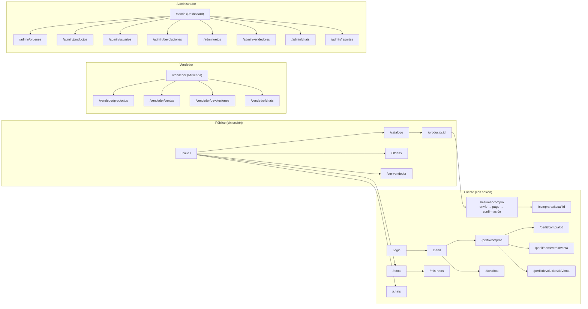

# Manual del Usuario — JADDA SPORTS

**Versión del documento:** 2.0 · 2026-10-30
**Audiencia:** visitantes, clientes, vendedores y administradores de la tienda
**Acceso:** navegador web en `http://<dirección-del-servidor>:5173` (o la app móvil de JADDA SPORTS)

> Manual estructurado según el formato requerido: Alcance · Requisitos de conocimiento · Requisitos de hardware y software del equipo del cliente · Mesa de ayuda · Política de seguridad · Estructura del software (Ingreso al sistema, Mapa de navegación, Funciones del sistema, Mensajes de error).

---

## 1. Alcance

Este manual explica cómo usar el sistema JADDA SPORTS desde el punto de vista del usuario final. Cubre:

| Componente | Alcanza |
|------------|---------|
| **Tienda web** | Navegación, catálogo, carrito, checkout, retos deportivos, favoritos, historial, chats, perfil, panel de vendedor y panel de administración |
| **App móvil** | Inicio, catálogo, detalle de producto, carrito, favoritos, perfil y compras |
| **Marketplace** | Publicación y venta de productos de vendedores externos con aprobación del administrador |
| **Pagos** | Pasarela Wompi (Tarjeta, PSE, Nequi, Daviplata, Bancolombia) o venta directa sin pasarela, con reembolsos automáticos por cancelación |
| **Post-venta** | Devoluciones/reembolsos con evidencias (fotos y videos), chat con el vendedor y escalación a soporte JADDA |

**No cubre** la instalación del sistema (ver *Manual de Instalación*) ni su mantenimiento técnico (ver *Manual Técnico de la Aplicación*).

## 2. Requisitos de conocimiento para operar el sistema

| Rol | Conocimientos necesarios |
|-----|--------------------------|
| **Visitante / Cliente** | Uso básico de un navegador (o de un celular con internet), manejo de su correo electrónico (para verificación, facturas y avisos) y experiencia general de compra en línea. No se requieren conocimientos técnicos ni de programación. La interfaz está completamente en español. |
| **Vendedor** | Lo anterior + manejo elemental de catálogos (crear/editar productos con fotos desde el PC, variantes color/talla) y de estados de pedidos y envíos. Opcional: lectura de reportes Excel/PDF. |
| **Administrador** | Lo anterior + conceptos de comercio electrónico (aprobación de publicaciones, gestión de órdenes, devoluciones y usuarios) y lectura de reportes (dashboard, Excel, PDF). No se requieren conocimientos de Base de Datos para la operación diaria. |

## 3. Requisitos de hardware y software del equipo del cliente

El sistema se usa desde el navegador: **no requiere instalar ningún programa** en el equipo del cliente (la aplicación vive en el servidor; ver requisitos del servidor en el *Manual de Instalación*).

| Equipo | Requisito mínimo | Recomendado |
|--------|------------------|-------------|
| **PC escritorio/portátil** | Windows 10/11, macOS o Linux, 4 GB de RAM, resolución 1280×720 | 8 GB de RAM, resolución 1366×768 o superior |
| **Navegador** | Chrome, Edge o Firefox de los 2 últimos años (soporte ES2020) | Última versión de Chrome o Edge |
| **Celular / Tablet** | Android 8+ (Chrome) o iOS 15+ (Safari); el sitio es responsive | Android 10+ con pantalla ≥ 5,5" |
| **App móvil (opcional)** | Android 8+ con Expo Go instalado o con el APK de JADDA SPORTS | Android 10+ |
| **Red** | Conexión al servidor: red local (LAN/Wi-Fi) donde está desplegada la tienda, o Internet si se publica externamente | Wi-Fi estable para subidas de evidencias |
| **Correo válido** | Gmail u otro proveedor que reciba los correos del sistema (códigos de verificación, factura PDF, notificaciones) | Revisar la carpeta *spam* |

## 4. Información sobre la mesa de ayuda

| Canal | Cómo acceder | Para qué |
|-------|--------------|----------|
| **Chat de soporte JADDA** | Menú de usuario → **Mis chats** → botón **"Nuevo soporte"** | Dudas, problemas con un pedido, ayuda general (la respuesta llega notificada en el timbre 🔔) |
| **Formulario PQR** | Menú de usuario → **Mi cuenta → PQR** | Peticiones, Quejas y Reclamos formales con seguimiento por estado |
| **Formulario de contacto** | Pie de página → **Contacto** | Consultas rápidas sin iniciar sesión |
| **Ayuda y soporte (FAQ)** | Pie de página → **Ayuda y Soporte** | Preguntas frecuentes: compras, envíos, devoluciones, retos |
| **Correo** | Responder cualquier correo del sistema (factura, notificación) | Apoyo cuando se necesite evidencia escrita |

**Tiempos de atención del sistema:**

| Solicitud | Compromiso del sistema |
|-----------|------------------------|
| Revisión de un avance de reto (cuando envías material) | Máximo **24 horas** |
| Aprobación de una solicitud de vendedor | Máximo **48 horas** (llegan credenciales por correo) |
| Confirmación de un pago Wompi | Automática en segundos (la página consulta sola; el pedido expira a los **10 minutos** sin pago) |
| Revisión de devolución/reembolso | Con seguimiento en la página de estado; el dinero se acredita en un máximo de **7 días** desde la aprobación |
| Chat de soporte | Queda abierto 24/7; la respuesta llega con notificación al timbre |

Si un vendedor rechazó tu devolución y no estás de acuerdo, usa el botón **"⚖️ Escalar a JADDA"** en la página de estado de la devolución: un hilo con el equipo de soporte decidirá el caso.

## 5. Política de seguridad

- **Contraseñas**: mínimo 8 caracteres, se guardan cifradas (bcrypt) — nadie del personal puede verlas ni enviarla por correo. Si se olvida, se restablece con un código al correo.
- **Verificación de correo**: al registrarte llega un **código de 6 dígitos válido 15 minutos**; el reenvío está limitado (3 por cada 30 minutos) para evitar abuso.
- **Bloqueo por intentos**: 10 intentos de login fallidos en 15 minutos bloquean temporalmente la IP (mensaje "Demasiadas solicitudes"); igual aplica a registro (5) y formularios públicos.
- **Sesión**: la sesión vive en una cookie segura (httpOnly, 24 horas). Al usar un equipo compartido, **cierra sesión** al terminar.
- **Datos de pago**: la tienda **NO almacena números de tarjeta ni CVV**; el cobro lo procesa la pasarela Wompi dentro de su checkout propio. Los métodos de pago guardados en tu perfil solo contienen datos de contacto (titular, teléfono/banco) para reutilizarlos en el checkout.
- **Cambios sensibles**: cambiar el correo exige un código enviado al correo nuevo; cambiar el teléfono vuelve a pedir tu contraseña.
- **Archivos**: solo se aceptan fotos/videos (jpg, png, webp, gif, mp4, webm, mov) hasta **25 MB por archivo y 5 archivos** en retos y devoluciones; las imágenes de productos (vendedor/admin) hasta **6 MB y 8 por producto**.
- **Uso aceptable**: chats y formularios censuran lenguaje ofensivo (reemplazado por asteriscos) y guardar contenido inapropiado puede llevar a la suspensión de la cuenta.
- **Privacidad**: consulta la **Política de Privacidad** ligada desde el pie del sitio: los datos personales solo se usan para operar la tienda, y las imágenes se almacenan en Cloudinary bajo carpetas propias del usuario (`jadda/perfiles/`, `jadda/retos/`, `jadda/devoluciones/`).
- **Cuenta de administrador**: no existen credenciales fijas en la aplicación; se define al instalar (variables `ADMIN_EMAIL` / `ADMIN_PASSWORD` del servidor) y debe cambiarse desde *Perfil → Seguridad* tras la puesta en marcha.

## 6. Estructura del software

### 6.1 Ingreso al sistema

1. **Crear cuenta**: botón **INICIAR SESIÓN / REGISTRO** (arriba a la derecha) → pestaña *Registro*: nombre, apellido, correo, contraseña (mín. 8) y dirección opcional.
2. **Verificar**: llega un **código de 6 dígitos** al correo (válido 15 min — hay temporizador en pantalla y botón **reenviar código**). Ingresarlo activa la cuenta.
3. **Iniciar sesión**: correo + contraseña; alternativamente **Continuar con Google** o **Facebook** (queda verificado automáticamente).
4. **Recuperar contraseña**: enlace "¿Olvidaste tu contraseña?" en el login → código al correo → nueva contraseña.
5. **Cuenta sin verificar en el login**: si intentas entrar antes de verificar, aparece el aviso *"Debes verificar tu correo"* con el botón **"SÍ, ENVIAR CÓDIGO"** para reenviarlo.
6. **Según tu rol se abre distinto**: cliente → la tienda; vendedor → su panel *Mi tienda*; administrador → el panel `admin` lateral.

### 6.2 Mapa de navegación

| Zona | Entrada en pantalla |
|------|---------------------|
| Visitante | Menú superior: **INICIO · CATÁLOGO (mega-menú) · OFERTAS · VENDER**; buscador arriba; carrito flotante abajo a la derecha |
| Cliente | Menú de usuario (avatar): **Ver perfil · Mis compras · Favoritos · Retos · Mis chats · Planes · PQR · Cerrar sesión** + timbre 🔔 |
| Vendedor | Botón de hamburguesa gris a la izquierda → sidebar *Mi tienda* con 8 pestañas |
| Administrador | Sidebar oscuro: Dashboard, Órdenes, Productos, Categorías, Usuarios, Devoluciones, Chats, Retos, Vendedores, Reportes |

### 6.3 Descripción de las funciones del sistema

#### 6.3.1 Visitante (sin cuenta)

| Quiero… | Haz esto |
|---------|----------|
| Ver el catálogo | Menú **CATÁLOGO** (mega-menú con categorías) o botón OFERTAS |
| Buscar un producto | Caja de búsqueda superior: escribe las **primeras letras** del nombre |
| Ver detalles | Clic en cualquier tarjeta: fotos con zoom, colores/tallas, descripción, reseñas |
| Filtrar por precio/categoría | Barra lateral del catálogo; **LIMPIAR FILTROS** reinicia |
| Chatear con un vendedor | Botón "💬 Chatear con el vendedor" en el producto de tienda externa |

> Para comprar, guardar favoritos o participar en retos **necesitas cuenta**.

#### 6.3.2 Cliente

**Comprar** — 1) En el producto elige **color y talla** (si aplica) y cantidad → **AGREGAR AL CARRITO** (el carrito flotante abre menú con subtotal y barra de envío gratis desde $800.000). 2) **COMPRAR** → resumen en 3 pasos: **Envío** (dirección guardada o nueva; el costo se calcula solo), **Pago** (elige método guardado o nuevo; el cobro se ejecuta en el checkout seguro de **Wompi** — se elige método dentro: Tarjeta, PSE, Nequi, Daviplata, Bancolombia) y **Confirmación** (resumen completo a pantalla; aquí también puedes **aplicar cupón** y ver "cupones disponibles"). 3) Al confirmar se abre **Wompi en pestaña nueva**; la página de la tienda queda **esperando confirmación** y cambia sola a **¡Gracias por tu compra!** o a **Pedido cancelado** (el stock vuelve a la tienda). Llega **correo con la factura PDF**.

**Seguir mis pedidos** (*Perfil → Mis compras*) — badge del estado real (Pendiente de pago / Por empaquetar / Empacado / En camino / Entregada / Cancelada), **Ver mi compra** (línea de tiempo, dirección editable hasta que el pedido salga, factura PDF), **pagar un pedido pendiente**, **cancelar pedido** (antes de que salga del almacén — con pago confirmado el reembolso es **automático**, incluye costo de envío) y **Volver a comprar**.

**Devoluciones y reembolsos post-entrega** (plazo: **3 días** desde la entrega) — desde Mis compras: *"Solicitar reembolso"* (solo si el producto llegó **dañado/defectuoso** o **no coincide con la descripción**, sin devolver nada) o *"Devolver producto"* (cambio de opinión: eliges productos, motivo, descripción y adjuntas **fotos/videos ≤ 25 MB**). En **"Ver estado de devolución"** sigues el timeline, adjuntas más evidencias si el equipo las pide y chateas embebido; el reembolso aprobado tiene comprobante con desglose.

**Retos deportivos** (*Menú → Retos*) — modal con instrucciones y términos al entrar; puedes unirte a **máximo 3 retos activos** (el badge "Cupos: X de 3" lo indica). Reportas avances (cantidad + hasta 5 archivos de 25 MB; en revisión ≤ 24 h; puedes eliminar avances pendientes). Al completar la meta llega un **cupón RETO- de un solo uso** (30 días de vigencia, compra mínima según su %) que aplicas en el checkout o desde "Ver cupones disponibles".

**Chat** (*Mis chats*) — soporte JADDA ("Nuevo soporte") o con el vendedor de un producto; burbujas, no leídos y **escalación** a JADDA desde una devolución no resuelta.

**Perfil** — datos personales, foto (clic en tu avatar), correo con verificación, teléfono con contraseña, direcciones y métodos de pago (marcar principal), **Favoritos** (con deshacer), historial de navegación, seguridad (última conexión) y 🔔 notificaciones.

#### 6.3.3 Vendedor

1. Solicita la cuenta: *menú → **Ser vendedor*** (empresa y NIT opcionales si vendes de forma informal); el admin aprueba en ≤ 48 h y **llega un correo con usuario y clave temporal** que debes cambiar al primer ingreso.
2. Las cuentas de vendedor **no pueden comprar** en la tienda.
3. Panel *Mi tienda* (8 secciones):

| Sección | Función |
|---------|---------|
| **Mi tienda** | KPIs: productos publicados/pendientes, unidades vendidas, ingresos y stock bajo |
| **Publicar producto** | Ficha con fotos desde el PC, variantes (color/talla/stock) y ficha técnica → queda *En revisión* hasta aprobación del admin |
| **Mis productos** | Estados *En revisión / Aprobado / Rechazado* (con motivo), editar y eliminar |
| **Mis ventas** | Pedidos con tus artículos: avanzas el envío (Pendiente → Entregado) y avisas al cliente |
| **Devoluciones** | Decides tus solicitudes (devolver/reembolsar/más pruebas/rechazar con motivo) y chateas con el cliente |
| **Chats** | Conversaciones con clientes y de devoluciones |
| **Reportes** | Ingresos, detalle y descarga **Excel/PDF** |
| **Configuración** | Teléfono, ubicación y dirección de contacto (empresa, NIT y correo bloqueados) |

#### 6.3.4 Administrador

| Sección | Qué hacer |
|---------|-----------|
| **Dashboard** | Resumen del día/30 días, ventas, pendientes y accesos rápidos |
| **Órdenes** | *Sin procesar / Procesadas*: **Gestionar** avanza el envío con línea de tiempo, muestra dirección y factura; cancelaciones con pago reembolsan **automáticamente** (productos + envío si no salió); canceladas permiten eliminar el registro |
| **Productos** | Buscar/ordenar, editar con galería ordenable y vista previa; aprobar/rechazar productos de vendedores; **Publicar** crea productos propios de JADDA |
| **Categorías / Descuentos / Proveedores** | Formularios de creación y edición |
| **Usuarios** | **Ver usuario**: compras, retos, direcciones, métodos y datos del vendedor |
| **Devoluciones y reembolsos** | Filtro por tipo; **Gestionar** abre toda la solicitud con evidencias; decidir: devolver (reingresa stock), reembolsar, más pruebas o rechazar con observación visible al cliente |
| **Chats** | Soporte, vendedores y devoluciones (hilos separados "comprador"/"vendedor", filtro de escaladas) |
| **Retos** | *No revisados / Ya revisados*: ver material, aprobar o rechazar con motivo (el material se conserva) |
| **Vendedores** | Aprobar (envía credenciales por correo) o rechazar con motivo |
| **Reportes** | Ventas por rango, más vendidos y descarga **Excel/PDF** |
| **Newsletter** | Ofertas automáticas cada **72 horas** con desuscripción en el pie; suscripción desde la tienda |

**Consejos generales:** los correos de verificación pueden llegar a *spam*; si no ves un botón es porque la regla del sistema no lo permite (ej. cancelar algo que ya salió); las evidencias multimedia requieren revisión humana, no se aprueban solas.

### 6.4 Descripción de los mensajes de error

| Mensaje (tal como aparece) | Situación | Qué hacer |
|---|---|---|
| "Correo o contraseña incorrectos" | Login con datos errados | Reintenta o usa "¿Olvidaste tu contraseña?" |
| "Debes verificar tu correo" + "¿Quieres que te enviemos al correo otro código?" | Login con cuenta sin verificar | Botón **SÍ, ENVIAR CÓDIGO** (reenvío a los 100 s) e ingresa el código |
| "El código es incorrecto o ha expirado" | Código de verificación vencido | Toca **reenviar código**; revisa *spam*; el temporizador en pantalla indica la vigencia |
| "Demasiadas solicitudes. Inténtalo de nuevo más tarde" | Superaste el límite de intentos por IP (login 10/15 min, registro 5/15 min, formularios públicos) | Espera unos minutos y reintenta |
| "El correo ya está registrado" | Registro con correo duplicado | Inicia sesión o recupera la contraseña con ese correo |
| "No hay suficiente stock de ..." durante la compra | Otra venta tomó las últimas unidades a la vez | Sigue con los demás productos; reintentar la compra con menos cantidad |
| "El cupón X requiere una compra mínima de $Y (tu carrito suma $Z)" | Cupón aplicado bajo el mínimo | Agrega más productos al carrito o quita el cupón (el descuento queda sin aplicar y **no se consume**) |
| "El cupón ya no está disponible" (RETO- usado o vencido) | Cupón de un solo uso ya usado o fuera de vigencia (30 días) | Usa otro cupón o compra sin él |
| "El pedido ya salió del almacén y no puede cancelarse" | Cancelar un pedido En camino/Entregado | Espera la entrega y usa *Devolver producto* o *Solicitar reembolso* (3 días post-entrega) |
| "No puedes editar la dirección porque el pedido ya salió del almacén" | Editar dirección tras el despacho | Comunícate por chat; ya no es editable |
| "El plazo de 3 días para pedir devolución ya venció" | Solicitar devolución/reembolso fuera de plazo | Contacta soporte desde *Mis chats* |
| "El reembolso sin devolución solo aplica si el producto llegó dañado o defectuoso o no coincide con la descripción. Si cambiaste de opinión, elige **Devolución**" | Reembolso con motivo que no califica | Elige tipo **Devolución** y cuéntanos tu motivo |
| "Ya existe una solicitud activa para este pedido" | Solicitar devolución dos veces | Abre "Ver estado de devolución" de la existente |
| "Solo puedes unirte a 3 retos a la vez. Completa uno para poder unirte a otro." | Unirse a un 4º reto activo | Completa uno de tus retos activos para liberar un cupo |
| "Los vendedores no pueden comprar en la tienda. Esta cuenta es solo para vender." | Carrito/checkout con cuenta de vendedor | Usa una cuenta de cliente normal para comprar |
| "Debes cambiar tu contraseña" (modal al primer ingreso de vendedor) | Contraseña temporal vigente | Define tu nueva contraseña; si cierras el modal el sistema cierra tu sesión |
| "Ya tienes una solicitud en revisión" | Solicitar ser vendedor dos veces | Espera la revisión (≤ 48 h) |
| "NIT / correo de empresa ya registrado" | Duplicado de datos de empresa | Usa datos correctos o inicia sesión con tu cuenta de vendedor |
| **Pantalla "No se pudo completar el pago"** + "Wompi rechazó el pago: {motivo}". No se realizó ningún cobro y tu pedido sigue reservado. | Pago declinado en Wompi | Botón **VOLVER A PAGAR CON WOMPI** con otra forma de pago; el pedido queda pendiente hasta expirar (10 min) |
| Pantalla "Pedido cancelado · El stock volvió a la tienda" | Pedido Wompi expiró sin pago (10 min) o el pago no se aprobó | Vuelve a comprar: el pedido cancelado no bloquea nada |
| "Máximo 5 archivos · cada archivo no debe superar los 25 MB" (retos/devoluciones) | Evidencia demasiado grande o de sobra | Recorta o comprime el archivo, o reduce la cantidad |
| "Origen no permitido" | Abrir el sitio desde una ventana o dominio inusual que lanza peticiones directas a la API | Vuelve a entrar por la dirección normal de la tienda (`:5173`) |
| Validaciones de formularios ("X es obligatorio", "entre 3 y 20 caracteres", "correo inválido", "teléfono de 10 dígitos") | Campos incompletos o inválidos | Revisa el campo marcado en **requerido** y corrige |
| "Petición rechazada" (400) | Petición mal formada (raro; tras un error de red) | Recarga la página (Ctrl+F5) e inténtalo de nuevo |

---
*Fin del manual — JADDA SPORTS.*
